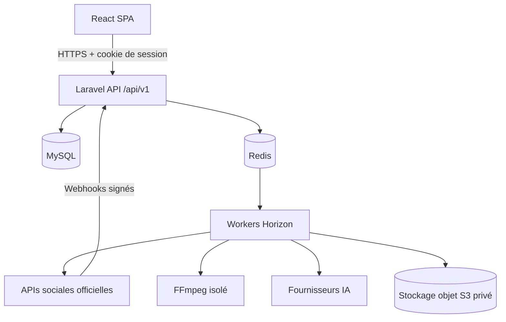

# SocialPulse — Documentation technique

> **Nom du produit** : « SocialPulse » dans la maquette, « Sociopulse » pour le dossier du projet.
> Le nom définitif reste à valider (voir [decisions.md](decisions.md), ADR-015).

## Objectif

SocialPulse est une plateforme web qui sert à gérer plusieurs réseaux sociaux depuis une seule interface :
connecter ses comptes, créer, adapter, programmer et publier du contenu, gérer ses médias, suivre ses statistiques,
utiliser l'IA et transformer de longues vidéos en clips courts.

Public visé : des créateurs, indépendants et petites structures **sans compétence technique particulière**.
La simplicité de l'expérience utilisateur est une exigence de premier rang.

La **V1 n'est pas un SaaS** : pas d'abonnement, de plan ni de facturation. L'architecture reste compatible
avec une évolution future vers `User → Workspace → Members → Roles/Permissions`.

## État du projet (2026-09-28)

| Élément | État |
|---|---|
| Code backend | **Socle Laravel livré** (`backend/`) — voir `backend/README.md` |
| Code frontend | **Frontend V1 livré** (`frontend/`, données simulées) — voir `frontend/README.md` |
| Maquette | Une planche raster unique : [`Images/maquette.png`](../Images/maquette.png) (1536×1024) |
| Visuels | [`Images/Image sect-hero.png`](../Images/Image%20sect-hero.png) (illustration du hero de la landing) |
| Git | Dépôt initialisé (branche `main`) |
| Documentation | Ce dossier `/docs` (phase 0) |

Il s'agit donc d'un projet **greenfield**. La phase 0 produit la documentation, qui sert de source de vérité.

## Stack cible

| Couche | Technologies |
|---|---|
| Frontend | React, TypeScript, Vite, Tailwind CSS, shadcn/ui, TanStack Query, React Hook Form (+ Zod, React Router — proposés) |
| Backend | Laravel (PHP 8.3+), Sanctum (auth SPA par cookie), Fortify (auth headless, compatible 2FA) — proposés |
| Base de données | **MySQL** — 8.0.30 via Laragon en dev, 8.4 LTS recommandé en production (ADR-003) |
| Queue / cache | Redis, Laravel Queue, Horizon |
| Stockage | Disque privé local en dev, stockage objet compatible S3 en production, URLs signées |
| Vidéo | FFmpeg / ffprobe dans un worker isolé |
| IA | Interface `AIServiceInterface`, indépendante du fournisseur |
| Réseaux sociaux | APIs officielles uniquement, via `SocialNetworkAdapter` |

## Architecture en une image



Style : **monolithe modulaire + traitements asynchrones**, sans microservices. Détails : [architecture.md](architecture.md).

## Structure prévue du dépôt

```text
Sociopulse/
├── backend/            # Application Laravel (créée en phase 1)
├── frontend/           # SPA React + Vite (créée en phase 1)
├── docker/             # Images et configuration (php, worker-ffmpeg, nginx, clamav)
├── docs/               # Cette documentation (source de vérité)
├── Images/             # Maquette et visuels fournis
├── .env.example        # Référentiel des variables d'environnement (à scinder en phase 1)
└── .gitignore
```

## Installation

Aucune installation n'est encore possible : le code n'existe pas. La procédure cible (phase 1) sera :

Environnement de développement : **Laragon** (ADR-014).

```bash
# 1. Laragon : démarrer MySQL et Redis ; créer la base `sociopulse` (utf8mb4_unicode_ci) et un utilisateur dédié
git clone <repo> && cd Sociopulse
cp backend/.env.example backend/.env      # renseigner les valeurs localement, jamais dans Git
cp frontend/.env.example frontend/.env
cd backend && composer install && php artisan key:generate && php artisan migrate --seed
php artisan serve            # ou virtual host Laragon (ex. sociopulse-api.test)
php artisan queue:work redis --queue=publishing,webhooks,notifications,media,ai,analytics,video
php artisan schedule:work
cd ../frontend && npm ci && npm run dev
```

**Prérequis constatés le 2026-09-28** : Laragon dans `C:\laragon` avec PHP 8.3.9, **MySQL 8.0.30**, **Redis 5.0.14**
(portage Windows), Node ; Composer 2.8.5 ; Node 24.16 et npm 11 ; Docker 29.
**Absents** : FFmpeg, ClamAV, stockage S3 local (MinIO). Extensions PHP absentes : `redis` (utiliser `predis/predis`),
`gd`/`imagick` (traitement d'image), `exif`, `sodium`, et `pcntl`/`posix`, qui n'existent pas sous Windows.
Conséquences sous Windows natif : **Horizon ne fonctionne pas** et **le `$timeout` des jobs n'est pas appliqué**
par `queue:work` (il dépend de `pcntl`). C'est acceptable en dev, mais les tests de robustesse des workers et la
production se font sous Linux (Docker ou WSL2).

## Documentation

| Document | Contenu |
|---|---|
| [cahier-des-charges.md](cahier-des-charges.md) | Spécification fonctionnelle : vision, utilisateurs, modules, périmètre V1 |
| [ux-ui.md](ux-ui.md) | Analyse de la maquette, design system, navigation, parcours, divergences |
| [architecture.md](architecture.md) | Architecture technique, domaines, queues, stockage, FFmpeg, flux |
| [database.md](database.md) | Schéma logique, colonnes, index, contraintes, MCD |
| [security.md](security.md) | Modèle de menaces et mesures de sécurité |
| [api-integration.md](api-integration.md) | Intégrations des réseaux sociaux (capacités marquées `TO_VERIFY`) |
| [development-roadmap.md](development-roadmap.md) | Phases 0 à 12, livrables et critères de sortie |
| [decisions.md](decisions.md) | Journal des décisions d'architecture (ADR) |

## Règle de travail

```text
Cahier des charges → UX/UI → Architecture → Database → Security → Implementation → Tests → Production
```

Toute implémentation doit respecter ces documents. Si un changement s'en écarte, on met d'abord à jour le
document concerné et on ajoute une entrée dans `decisions.md`.
