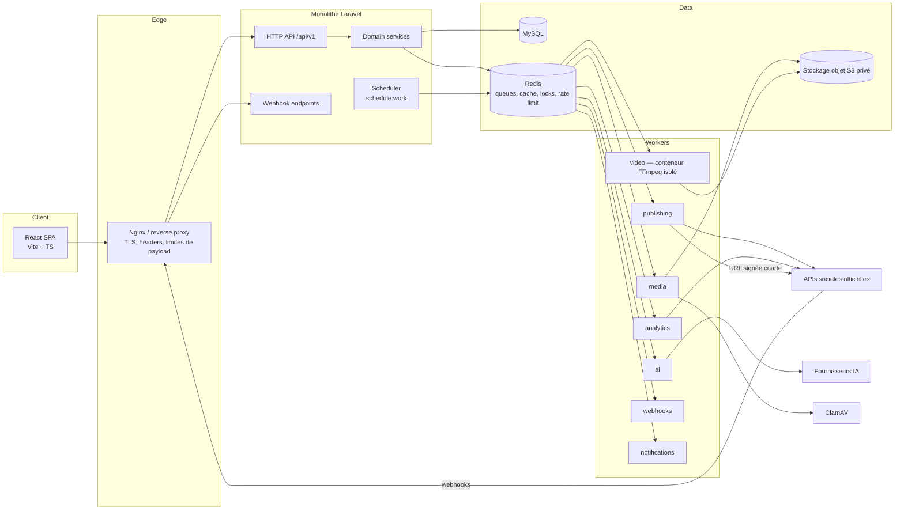
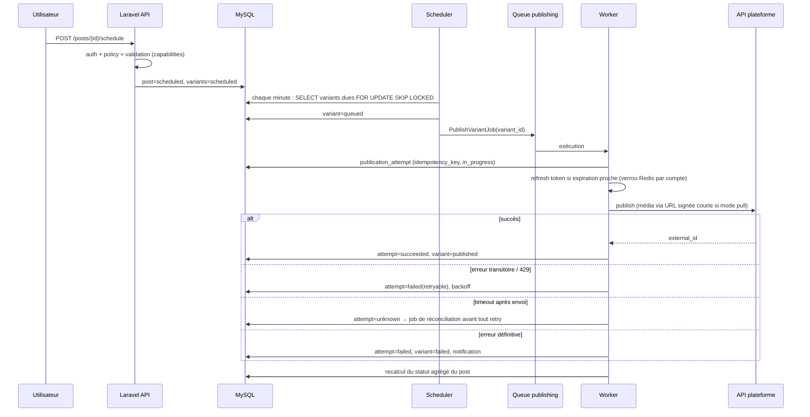

# Architecture technique

Statut : cible de la V1, rédigée en phase 0. Les choix techniques non imposés par le brief sont marqués **(proposé)** et reliés à un ADR.

---

## 1. Principes

1. **Monolithe modulaire** : une application Laravel, des domaines séparés logiquement (ADR-001).
2. **Asynchrone par défaut** pour tout appel externe ou traitement lourd : publication, médias, vidéo, IA, analytics, webhooks.
3. **Adaptateurs** pour les réseaux sociaux et les fournisseurs IA : le cœur métier ne dépend d'aucun SDK tiers.
4. **Sécurité intégrée** : chaque route suit Authentification → Autorisation → Validation → Métier.
5. **Prêt pour les workspaces** : la propriété des données passe par un point unique (policies + scopes) (ADR-007).

## 2. Vue d'ensemble



## 3. Organisation du dépôt (proposé, ADR-002)

```text
Sociopulse/
├── backend/     # Laravel — API JSON uniquement, pas de vues Blade applicatives
├── frontend/    # React SPA
├── docker/      # Dockerfiles : php-fpm, worker, worker-ffmpeg, nginx
├── docs/
└── docker-compose.yml
```

Le frontend et l'API sont servis sous le **même site** (par exemple `app.example.com` et `api.example.com`, ou
`example.com/api`) pour permettre l'authentification Sanctum par cookie (`SameSite=Lax`) sans token dans le navigateur.

## 4. Backend

### 4.1 Structure

Structure conforme au brief. `Models/`, `Jobs/`, `Events/` et `Listeners/` restent à la racine de `app/`, selon la convention Laravel.

```text
backend/app/
├── Domain/
│   ├── Social/
│   │   ├── Contracts/SocialNetworkAdapter.php
│   │   ├── Adapters/{Facebook,Instagram,TikTok,YouTube,LinkedIn,X,Pinterest,Threads}Adapter.php
│   │   ├── Capabilities/{Capability.php (enum), CapabilitySet.php}
│   │   ├── OAuth/          # state, PKCE, échange de code, refresh
│   │   ├── Data/           # DTO : PublishRequest, PublishResult, AccountProfile, MetricSet
│   │   ├── Exceptions/     # RateLimited, TokenExpired, PermissionMissing, PlatformRejected, Transient
│   │   └── SocialAccountService.php
│   ├── Publishing/         # orchestration, agrégation de statuts, idempotence
│   ├── Scheduling/         # sélection des variantes dues, verrous
│   ├── Media/              # pipeline d'upload, validation, dérivés
│   ├── Analytics/          # normalisation, snapshots
│   ├── AI/
│   │   ├── Contracts/AIServiceInterface.php
│   │   ├── Providers/      # ProviderA, ProviderB… (pas de couplage fort)
│   │   └── Prompts/        # gabarits versionnés
│   ├── Clipping/           # projets, transcription, détection, rendu
│   └── Notifications/
├── Http/
│   ├── Controllers/Api/V1/
│   ├── Requests/           # FormRequest : validation stricte
│   ├── Resources/          # API Resources : jamais de modèle brut sérialisé
│   └── Middleware/
├── Policies/
├── Jobs/                   # sous-dossiers par domaine : Jobs/Publishing/PublishVariantJob.php…
├── Events/ Listeners/
├── Models/
├── Services/               # services transverses : AuditLogger, SecretRedactor, SignedUrlService
└── Support/
```

Règles :
- Les contrôleurs restent minces : `FormRequest` → `authorize()` via Policy → Action ou Service du domaine → `Resource`.
- Un domaine n'accède pas aux tables d'un autre domaine en écriture. Il passe par un service ou un événement.
- Les objets de données (DTO) circulent entre les domaines. Les appels aux adaptateurs utilisent des DTO, jamais de modèles Eloquent.

### 4.2 Adaptateurs de réseaux sociaux

```php
interface SocialNetworkAdapter
{
    public function platform(): PlatformKey;
    public function capabilities(AccountType $type): CapabilitySet;       // déclaratif, versionné dans le code
    public function authorizationUrl(OAuthState $state): string;           // + PKCE si supporté
    public function exchangeCode(string $code, OAuthState $state): TokenSet;
    public function refresh(TokenSet $tokens): TokenSet;                   // lève TokenRefreshNotSupported
    public function revoke(TokenSet $tokens): void;
    public function fetchAccounts(TokenSet $tokens): array;               // pages, chaînes, profils
    public function fetchGrantedScopes(TokenSet $tokens): array;
    public function validate(PublishRequest $request): ValidationResult;  // contraintes plateforme
    public function publish(PublishRequest $request): PublishResult;
    public function fetchPublicationStatus(string $externalId): PublishResult; // flux asynchrones (containers IG, TikTok)
    public function fetchAccountMetrics(AccountRef $acc, Period $p): MetricSet;
    public function fetchPostMetrics(AccountRef $acc, string $externalId): MetricSet;
    public function verifyWebhook(Request $request): WebhookVerification;
    public function parseWebhook(Request $request): array;               // WebhookEvent DTO[]
}
```

`Capability` (enum) : `TEXT_POST`, `IMAGE_POST`, `MULTI_IMAGE_POST`, `VIDEO_POST`, `STORY`, `REEL_SHORT`,
`NATIVE_SCHEDULING`, `ACCOUNT_ANALYTICS`, `POST_ANALYTICS`, `WEBHOOKS`, `ADS` (réservé), `FIRST_COMMENT`, `LINK_PREVIEW`.
Chaque capacité porte un **statut** : `supported`, `unsupported`, `requires_review`, `to_verify`. Le frontend
lit ces capacités via l'API pour activer ou désactiver les options du composer. Une capacité `to_verify` est
traitée comme non supportée en production.

Enregistrement : un `SocialAdapterRegistry` résout l'adaptateur à partir de `social_platforms.key`.
Les clients HTTP utilisent `Http::` de Laravel avec timeouts, retries contrôlés et un middleware de journalisation expurgée.

### 4.3 Publication : flux



**Idempotence et doublons** : la plupart des APIs de publication ne sont pas idempotentes. Quand une requête
a pu être reçue par la plateforme sans que la réponse nous parvienne (timeout, coupure réseau), la tentative
passe à `unknown`. Le système **ne republie jamais automatiquement** dans cet état. Il tente une réconciliation
(lecture des derniers posts du compte, statut du container) et, à défaut, demande une action à l'utilisateur.

**Programmation** : V1 = programmation **interne** uniforme (ADR-010). La programmation native des
plateformes (Facebook, YouTube `publishAt`) pourra devenir une option plus tard.

### 4.4 Queues et workers

| Queue | Jobs principaux | Timeout (indicatif) | Tries / backoff | Concurrence |
|---|---|---|---|---|
| `publishing` | PublishVariantJob, ReconcilePublicationJob, CheckContainerStatusJob | 120 s | 5 / 30 s, 2 min, 10 min, 30 min | moyenne, limitée par compte |
| `media` | ScanMediaJob, ProcessImageJob, GenerateThumbnailJob | 300 s | 3 / exponentiel | moyenne |
| `video` | ProbeVideoJob, ExtractAudioJob, RenderClipJob, BurnSubtitlesJob | 1800 s | 2 / 5 min | faible (CPU) |
| `ai` | GenerateTextJob, TranscribeJob, DetectClipsJob | 300 s | 3 / exponentiel | limitée par utilisateur |
| `analytics` | SyncAccountMetricsJob, SyncPostMetricsJob | 180 s | 3 / 10 min | faible (quotas API) |
| `webhooks` | ProcessWebhookEventJob | 60 s | 5 / exponentiel | élevée |
| `notifications` | SendNotificationJob (mail, base de données) | 60 s | 3 | moyenne |

Chaque job :
- reçoit uniquement des **identifiants** et recharge l'état depuis la base (aucun secret dans le payload sérialisé) ;
- est **idempotent** : il vérifie l'état avant d'agir et utilise `ShouldBeUnique` ou des verrous Redis si nécessaire ;
- définit `$timeout`, `$tries`, `backoff()`, `failed()` et `retryUntil()` quand c'est pertinent ;
- est **traçable** : un `correlation_id` est propagé dans les logs et `publication_attempts.job_uuid` est renseigné ;
- lève des exceptions typées : `Transient` (on réessaie) ou `Permanent` (échec immédiat, `$this->fail()`).

Supervision : **Laravel Horizon** (tableau de bord protégé par une Gate admin et masqué en production derrière
un VPN ou une IP autorisée). Les `failed_jobs` sont conservés et purgés au-delà de N jours.
Horizon nécessite `pcntl` : en production et en staging, les workers tournent sous Linux. En dev sous Laragon
(Windows), on utilise `php artisan queue:work`, sans Horizon, et les timeouts de jobs ne sont pas appliqués (limitation connue, ADR-014).
Redis de Laragon (5.0.14) : pas d'ACL (ajoutées en Redis 6). En production, Redis ≥ 7 avec ACL.

Le scheduler (`routes/console.php`) déclenche : la dispatch des publications dues (chaque minute), le refresh
préventif des tokens, la synchronisation analytics (cadence par plateforme selon les quotas), la purge des
fichiers temporaires, la purge des médias supprimés et la vérification de la santé des comptes.

### 4.5 Redis

Usages : queues, cache, verrous atomiques (refresh de token par compte, publication par variante) et compteurs de rate limiting.
Redis n'est **jamais exposé sur Internet** : réseau privé, mot de passe ou ACL, TLS si hors hôte, `rename-command`
ou ACL pour désactiver `FLUSHALL`, `CONFIG` et `KEYS`. Des bases logiques séparent cache et queues, pour qu'un
`cache:clear` ne vide pas les queues.

### 4.6 Stockage des médias

- Disque `media` : local privé (`storage/app/private`) en dev, **S3 ou compatible** en production (bucket privé, Block Public Access, SSE).
- Clés d'objet générées côté serveur : `users/{user_uuid}/media/{media_uuid}/{variant}.{ext}`. Le nom d'origine n'est jamais utilisé.
- Upload : envoi direct du navigateur vers S3 via **URL présignée PUT** (multipart pour les gros fichiers) dans un
  préfixe `quarantine/`, puis le job de validation et d'antivirus promeut le fichier vers `media/`. En dev, l'upload passe par l'API.
- Lecture par le frontend : **URLs signées GET** courtes (5 à 15 min) générées après autorisation.
- **Plateformes en mode « pull »** (Instagram, Threads, TikTok `PULL_FROM_URL`, Pinterest…) : elles exigent une URL
  HTTPS publique. On génère une URL signée à durée courte (≤ 1 h, `TO_VERIFY` selon les délais de traitement),
  à usage unique si le fournisseur de stockage le permet, pour ce seul fichier (ADR-012). Pour TikTok en mode pull,
  une vérification de domaine est requise, donc il faut un domaine de diffusion dédié.

### 4.7 FFmpeg

- Worker `video` dans un **conteneur dédié** : utilisateur non root, système de fichiers en lecture seule sauf un
  répertoire de travail temporaire, **sans accès réseau** (les fichiers sont téléchargés depuis S3 par un
  processus séparé), limites cgroups CPU et mémoire, `ulimit`.
- Invocation via `Symfony\Component\Process\Process` avec **tableau d'arguments** (jamais de chaîne shell),
  timeout, `-nostdin`, `-protocol_whitelist file`, `-hide_banner`.
- `ffprobe` d'abord : codecs autorisés, durée, résolution et nombre de flux maximum. Tout fichier hors limites est rejeté.
- Paramètres utilisateur (début, fin, ratio, style de sous-titres) **validés et typés** (entiers en ms, enum de ratios),
  puis traduits en arguments par le code. Les sous-titres sont générés en fichier `.ass` ou `.srt` par le code et échappés.
- Un répertoire temporaire par job est supprimé dans un `finally`, et une purge planifiée rattrape les orphelins.
- Sortie validée (ffprobe) avant enregistrement comme média `ready`.

### 4.8 IA

```php
interface AIServiceInterface
{
    public function generateText(TextGenerationRequest $r): TextGenerationResult;   // posts, captions, hashtags, scripts, ton
    public function transcribe(TranscriptionRequest $r): TranscriptionResult;       // peut être un autre fournisseur
    public function analyzeTranscript(ClipDetectionRequest $r): ClipDetectionResult;
}
```

- Sélection du fournisseur par configuration (`config/ai.php` : fournisseur par tâche, modèle, timeouts, limites).
- Les DTO sont neutres : aucune structure propre à un fournisseur ne sort de `Domain/AI/Providers`.
- Les gabarits de prompts sont versionnés dans le code. `ai_generations` enregistre la version, le fournisseur, le modèle, les tokens et la latence.
- Les sorties IA sont des **données non fiables** : elles sont affichées comme suggestions, jamais exécutées, et validées (JSON schema) avant usage (par exemple les horodatages de clips bornés à la durée de la vidéo).
- Aucun token OAuth ni secret n'est envoyé à un fournisseur IA.

### 4.9 Webhooks

`POST /webhooks/{platform}` sans session ni CSRF, protégé par une signature. Enchaînement :
vérification de signature → contrôle anti-rejeu (horodatage) → clé d'idempotence → insertion `webhook_events`
(contrainte unique) → réponse 200 rapide → `ProcessWebhookEventJob`. Endpoints annexes : vérification d'abonnement
(challenge Meta), callbacks de désautorisation et de suppression de données (Meta).

### 4.10 Notifications

Canaux V1 : base de données (centre de notifications) et mail. Les listeners des événements de domaine
(`VariantPublished`, `VariantFailed`, `SocialAccountExpired`, `ClipRendered`…) créent les notifications. Les
préférences utilisateur filtrent les canaux. Temps réel (Laravel Reverb) : hors V1 ; le frontend interroge
périodiquement via TanStack Query (`refetchInterval`) les écrans qui en ont besoin.

### 4.11 Conventions d'API

- Préfixe `/api/v1`. JSON uniquement. Identifiants publics = UUID.
- Pagination par **curseur** pour les listes volumineuses (médias, notifications, audit), bornée (`per_page` ≤ 100).
- Erreurs normalisées : `{ "error": { "code": "...", "message": "...", "details": {...} }, "request_id": "..." }` ; 422 pour la validation (format Laravel conservé).
- Aucune donnée d'une autre ressource utilisateur n'est accessible : toutes les requêtes passent par une Policy et par un scope de propriété.
- Endpoints longs (publication, rendu, IA) : réponse **202 Accepted** avec la ressource et son statut, puis polling.

## 5. Frontend

### 5.1 Stack

React + TypeScript (strict) + Vite, Tailwind CSS, shadcn/ui (Radix), TanStack Query, React Hook Form + **Zod** (proposé),
**React Router** (proposé ; TanStack Router est une alternative), lucide-react (icônes par défaut de shadcn),
Recharts (via les composants chart de shadcn), date-fns + date-fns-tz. Calendrier : composant maison basé sur
date-fns ou FullCalendar (licence MIT pour le cœur, `TO_VERIFY` pour les vues souhaitées). À trancher en phase 6.

### 5.2 Structure

```text
frontend/src/
├── app/            # routeur, providers (QueryClient, thème), layout
├── components/ui/  # composants shadcn générés
├── components/     # composants partagés (PlatformIcon, StatusBadge, StatCard, EmptyState…)
├── features/
│   ├── auth/ onboarding/ dashboard/ composer/ calendar/
│   ├── social-accounts/ media/ video-studio/ analytics/
│   └── notifications/ settings/ security/
│       └── (api.ts, hooks.ts, schemas.ts, components/, pages/)
├── lib/            # client HTTP (fetch + CSRF Sanctum), formatters, i18n
└── styles/         # tokens Tailwind (design system de la maquette)
```

### 5.3 Règles
- Le client HTTP envoie `credentials: 'include'` et initialise `/sanctum/csrf-cookie`. **Aucun token dans le localStorage.**
- Les permissions affichées par le frontend sont un confort d'UX. Le serveur reste la seule autorité.
- Les URLs de médias sont signées et temporaires : ne pas les mettre en cache au-delà de leur durée de validité.
- Clés de requête TanStack Query par domaine (`['posts', filters]`), invalidation après mutation.

## 6. Environnements et déploiement

| Environnement | Composition |
|---|---|
| Dev (Windows) | **Laragon** : PHP 8.3.9, MySQL 8.0.30, Redis 5.0.14, Nginx/Apache, Node. `php artisan queue:work` et `schedule:work` en local ; FFmpeg Windows (binaire à installer) ; mail via Mailpit ou le `sendmail` de Laragon. **Optionnel** en Docker ou WSL2 : ClamAV, MinIO (S3 local), worker FFmpeg isolé et Horizon (ADR-014) |
| Staging | Identique à la production, applications sociales en mode dev ou test |
| Production | Reverse proxy TLS, app sans état (≥ 2 instances), workers séparés par queue, MySQL 8.4 LTS managé, Redis privé, S3, sauvegardes |

Secrets : variables d'environnement injectées par l'hébergeur ou un gestionnaire de secrets, jamais dans Git.
CI : lint (Pint, ESLint), analyse statique (Larastan/PHPStan), tests (Pest/PHPUnit, Vitest), `composer audit`,
`npm audit`, scan de secrets (gitleaks).

## 7. Flux de données principaux

| Flux | Chemin |
|---|---|
| Connexion OAuth | SPA → `GET /api/v1/social/{platform}/connect` → redirection plateforme → `GET /oauth/{platform}/callback` (state + PKCE) → tokens chiffrés → `fetchAccounts` → redirection SPA |
| Upload média | SPA → `POST /media/uploads` (autorisation, quotas) → URL présignée → S3 `quarantine/` → `POST /media/{id}/complete` → queue `media` (MIME, magic bytes, antivirus, dérivés) → `ready` |
| Publication | voir 4.3 |
| Analytics | Scheduler → `SyncAccountMetricsJob` → adaptateur → `analytics_snapshots` (brut) → normaliseur → `analytics` |
| Clipping | Upload → `video_projects` → probe → extraction audio → transcription (IA) → détection (IA) → `video_clips` suggérés → édition → `RenderClipJob` (FFmpeg) → média `ready` |
| Webhook | voir 4.9 |
