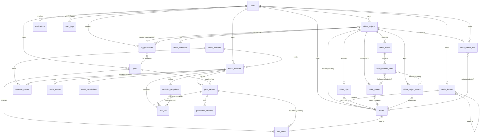

# Base de données

SGBD retenu : **MySQL** (ADR-003, décision du porteur de projet).
- **Développement** : MySQL **8.0.30** fourni par **Laragon** (`C:\laragon\bin\mysql\mysql-8.0.30-winx64`, constaté le 2026-09-28).
- **Production** : **MySQL 8.4 LTS** recommandé. La branche 8.0 est en fin de support (EOL avril 2026, `TO_VERIFY`) : il faut
  tester la compatibilité 8.0 ↔ 8.4 en CI et, idéalement, faire évoluer Laragon vers 8.4.

Fonctions MySQL utilisées (toutes disponibles en 8.0.30) : contraintes `CHECK` appliquées (≥ 8.0.16), colonnes générées,
index fonctionnels (≥ 8.0.13), index multi-valués sur JSON (≥ 8.0.17), index `FULLTEXT` InnoDB.
MySQL **n'a pas** d'index uniques partiels ni de `NULLS NOT DISTINCT` : on les émule par des **colonnes générées**
(section 1.1). Ces émulations sont marquées **[MySQL]** dans les tables ci-dessous.

---

## 1. Conventions

| Règle | Détail |
|---|---|
| Moteur / encodage | InnoDB, **`utf8mb4` / `utf8mb4_unicode_ci`** (obligatoire : les posts contiennent des emojis). `sql_mode` strict (`STRICT_TRANS_TABLES`, `ONLY_FULL_GROUP_BY`…, par défaut dans Laravel `strict => true`). |
| Clés primaires | `id` **UUID v7** (ordonné dans le temps) via `HasUuids` de Laravel, stocké en `char(36)` (colonne `uuid()` de Laravel sous MySQL) (ADR-004). L'UUID est aussi l'identifiant public : aucun identifiant séquentiel n'est exposé. L'ordre temporel de v7 limite la fragmentation de l'index clusterisé InnoDB. |
| Clés étrangères | Toutes contraintes en base (`foreignUuid()->constrained()`), avec `ON DELETE` explicite. Seule exception : les colonnes polymorphes de `audit_logs` et `notifications`, justifiées plus bas. |
| Horodatage | Toujours en **UTC** : `APP_TIMEZONE=UTC` et `time_zone = '+00:00'` sur la connexion. `timestamps()` de Laravel (type `TIMESTAMP`) pour `created_at`/`updated_at`. Les dates métier (`scheduled_at`, `expires_at`, `published_at`…) sont en **`DATETIME`**, ce qui évite la limite 2038 du type `TIMESTAMP` et les conversions implicites de fuseau. Le fuseau de l'utilisateur est stocké à part. Dans les tableaux ci-dessous, « datetime » désigne ce type. |
| Statuts | Colonnes `varchar(32)` + contrainte `CHECK` + enum PHP (`backed enum`). Pas de type `ENUM` MySQL : chaque ajout de valeur exigerait un `ALTER TABLE` bloquant. |
| JSON | Type `json` MySQL (validé à l'insertion). |
| Suppression | `deleted_at` (soft delete) sur les entités utilisateur récupérables. Une purge planifiée gère la suppression définitive (RGPD). |
| Propriété | Chaque table racine porte `user_id`. Les tables enfants héritent de la propriété via leur parent (ADR-007). |
| Secrets | Suffixe `_encrypted` pour les colonnes chiffrées côté application. Jamais indexées, jamais sérialisées. |
| Nommage | snake_case, tables au pluriel, colonnes de clés étrangères `<entité>_id`. |

### 1.1 Émulations MySQL

| Besoin | Émulation MySQL |
|---|---|
| Unicité partielle (ex. un seul token `active` par compte) | Colonne générée `active_marker TINYINT AS (IF(status = 'active', 1, NULL)) STORED` + `UNIQUE(social_account_id, token_kind, active_marker)` : les `NULL` ne se heurtent pas, seules les lignes actives sont contraintes. |
| Unicité avec colonne nullable traitée comme valeur (`NULLS NOT DISTINCT`) | Colonne générée `<col>_key CHAR(36) AS (COALESCE(<col>, '')) VIRTUAL`, indexée, utilisée dans l'index unique à la place de la colonne nullable. **`VIRTUAL` et non `STORED`** : MySQL interdit `ON DELETE CASCADE / SET NULL` sur la colonne de base d'une colonne générée `STORED`, or ces colonnes sont des clés étrangères (**vérifié le 2026-09-29 sur MySQL 8.0.30** : cascade à travers une colonne VIRTUAL indexée ; à revérifier sur 8.4 en CI). Si le test échoue : trigger ou contrôle applicatif sous verrou. |
| Index sur tableau JSON (tags) | Index multi-valué : `INDEX ((CAST(tags AS CHAR(64) ARRAY)))`, requête via `MEMBER OF` / `JSON_CONTAINS`. |
| Recherche textuelle (nom de média) | Index `FULLTEXT(original_name)` + `MATCH … AGAINST` en mode booléen ; `LIKE 'prefix%'` pour l'autocomplétion. |
| Email insensible à la casse | Collation `_ci` de la colonne (comparaison déjà insensible à la casse) + normalisation `lower()` à l'écriture. |
| Adresse IP | `varchar(45)` (IPv4 et IPv6 en texte). |
| Sélection concurrente des publications dues | `SELECT … FOR UPDATE SKIP LOCKED` (supporté depuis MySQL 8.0.1). |

Les colonnes générées et les index fonctionnels s'écrivent dans les migrations Laravel avec `->storedAs()` / `->virtualAs()` et `DB::statement()` si nécessaire.

**Préparation des workspaces** : ne pas créer `workspaces` maintenant. Le jour venu, on ajoute une colonne
`workspace_id` aux tables racines (`social_accounts`, `posts`, `media`, `media_folders`, `video_projects`,
`ai_generations`), on la remplit avec un workspace personnel par utilisateur et on ne change que les
scopes et les Policies. Pour que cette migration reste mécanique, **aucune requête ne filtre directement
`where('user_id', …)`** : on passe par le scope `ownedBy($actor)` et par les Policies.

## 2. Tables techniques Laravel

`sessions` (driver de session `database` ou `redis`), `password_reset_tokens`, `cache`, `cache_locks`
(si le cache n'est pas Redis), `jobs`, `job_batches`, `failed_jobs`, `personal_access_tokens` (non utilisé en
V1 : l'authentification se fait par session SPA). Elles suivent les migrations standard du framework.

## 3. Tables métier

### 3.1 AUTH

#### `users`
| Colonne | Type | Contraintes / notes |
|---|---|---|
| id | uuid | PK |
| name | varchar(120) | not null |
| email | varchar(254) | not null, **unique** (collation `utf8mb4_unicode_ci` (insensible à la casse) + normalisation en minuscules à l'écriture) |
| email_verified_at | datetime | null |
| password | varchar(255) | hash **Argon2id** |
| two_factor_secret | text | null, chiffré (Fortify) |
| two_factor_recovery_codes | text | null, chiffré |
| two_factor_confirmed_at | datetime | null |
| timezone | varchar(64) | not null, défaut `Europe/Paris`, validé contre la liste IANA |
| locale | varchar(10) | not null, défaut `fr` |
| status | varchar(32) | `active` \| `suspended` (CHECK) |
| last_login_at | datetime | null |
| headline | varchar(60) | null — « Activité » affichée dans l'interface (ADR-028) |
| bio | varchar(280) | null — « Présentation » (ADR-028) |
| remember_token | varchar(100) | null |
| created_at, updated_at, deleted_at | timestamp | |

#### `notifications` (table standard des notifications Laravel)
| Colonne | Type | Notes |
|---|---|---|
| id | uuid | PK |
| type | varchar(255) | classe de notification |
| notifiable_type, notifiable_id | varchar, uuid | polymorphe (`uuidMorphs`) — **exception au principe des clés étrangères** : convention du framework, le destinataire est toujours `users` en V1 ; purge applicative à la suppression de l'utilisateur |
| data | json | aucun secret, aucun token |
| read_at | datetime | null |
| created_at, updated_at | timestamp | |
Index : (`notifiable_type`, `notifiable_id`, `read_at`), (`created_at`).

### 3.2 SOCIAL

#### `social_platforms`
| Colonne | Type | Notes |
|---|---|---|
| id | uuid | PK |
| key | varchar(32) | **unique** : `facebook`, `instagram`, `tiktok`, `youtube`, `linkedin`, `x`, `pinterest`, `threads` |
| name | varchar(64) | libellé affiché |
| availability | varchar(32) | `available` \| `coming_soon` \| `disabled` (maquette : « Bientôt disponible ») |
| capabilities | json | **copie** des capacités déclarées par l'adaptateur (la source de vérité reste le code), resynchronisée au déploiement |
| api_version | varchar(32) | version d'API utilisée par l'adaptateur (ex. Graph `vXX.0` `TO_VERIFY`) |
| created_at, updated_at | timestamp | |
Données de référence alimentées par un seeder.

#### `social_connections` — **PROPOSÉE** (ADR-019, à valider en phase 3)
Une autorisation OAuth peut donner accès à **plusieurs** comptes publiables (un token utilisateur Facebook →
N pages ; un token Google → 1..N chaînes). Le brief ne prévoit pas de table pour cette « autorisation » parente.
Deux options :
- **A (recommandée)** : table `social_connections` (user_id, social_platform_id, external_user_id, status),
  à laquelle se rattache le token « utilisateur » ; chaque `social_account` référence sa connexion.
- **B (fidèle au brief)** : pas de table supplémentaire. `social_tokens.token_kind = user|page` ; le token
  utilisateur est rattaché au compte principal.
Le reste de ce document suit le brief (option B) en attendant la décision.

#### `social_accounts`
| Colonne | Type | Notes |
|---|---|---|
| id | uuid | PK |
| user_id | uuid | FK `users` ON DELETE CASCADE |
| social_platform_id | uuid | FK `social_platforms` ON DELETE RESTRICT |
| external_account_id | varchar(191) | identifiant côté plateforme |
| account_type | varchar(32) | `profile` \| `page` \| `business` \| `creator` \| `channel` \| `organization` \| `board_owner` |
| display_name | varchar(255) | |
| username | varchar(255) | null |
| avatar_media_path | varchar(512) | null — avatar **copié** dans notre stockage (les URLs des CDN des plateformes expirent) |
| status | varchar(32) | `connected` \| `expired` \| `revoked` \| `error` (CHECK) |
| status_reason | varchar(255) | null, message non sensible |
| connected_at, last_synced_at, last_error_at | datetime | |
| metadata | json | informations non sensibles (catégorie de page, lien vers le compte Facebook d'un compte Instagram…) |
| created_at, updated_at, deleted_at | timestamp | |
Contraintes : **unique** (`user_id`, `social_platform_id`, `external_account_id`). Index : (`user_id`, `status`).

#### `social_tokens` (donnée **critique**)
| Colonne | Type | Notes |
|---|---|---|
| id | uuid | PK |
| social_account_id | uuid | FK `social_accounts` ON DELETE CASCADE |
| token_kind | varchar(16) | `user` \| `page` \| `app` \| `portability` (autorisation Google Data Portability du compte YouTube, ADR-054 ; migration `2026_10_11_155113`) |
| access_token_encrypted | text | chiffré (AES-256-GCM, clé dédiée, voir security.md §5) |
| refresh_token_encrypted | text | null, chiffré |
| expires_at | datetime | null (certains tokens n'expirent pas) |
| refresh_expires_at | datetime | null |
| scopes | json | tableau de scopes accordés |
| token_type | varchar(32) | ex. `bearer` |
| status | varchar(32) | `active` \| `expired` \| `revoked` \| `invalid` |
| encryption_key_version | smallint | pour la rotation de clé |
| last_refreshed_at | datetime | null |
| created_at, updated_at | timestamp | |
Contraintes : **un seul token actif par compte et par type** — **[MySQL]** colonne générée `active_marker` (1 si `active`, sinon NULL) + UNIQUE (`social_account_id`, `token_kind`, `active_marker`) (voir §1.1).
Index : (`status`, `expires_at`) pour le refresh préventif.
Modèle Eloquent : `$hidden` pour toutes les colonnes de token, aucun `toArray()` exposé, aucune API Resource.

#### `social_permissions`
| Colonne | Type | Notes |
|---|---|---|
| id | uuid | PK |
| social_account_id | uuid | FK ON DELETE CASCADE |
| scope | varchar(128) | ex. `pages_manage_posts` |
| status | varchar(16) | `granted` \| `declined` \| `missing` |
| is_required | boolean | requis pour au moins une capacité utilisée |
| checked_at | datetime | |
Contrainte : **unique** (`social_account_id`, `scope`).

#### `webhook_events`
| Colonne | Type | Notes |
|---|---|---|
| id | uuid | PK |
| social_platform_id | uuid | FK ON DELETE RESTRICT |
| social_account_id | uuid | null, FK ON DELETE SET NULL (résolu après parsing) |
| external_event_id | varchar(191) | null (toutes les plateformes n'en fournissent pas) |
| idempotency_key | char(64) | SHA-256 de (`platform` + `external_event_id`), ou du corps brut canonique à défaut — **unique** |
| event_type | varchar(128) | |
| signature_valid | boolean | les événements invalides ne sont **pas** stockés (seulement journalisés et comptés) |
| payload | json | corps expurgé de tout secret |
| received_at | datetime | |
| status | varchar(16) | `received` \| `queued` \| `processing` \| `processed` \| `failed` \| `ignored` |
| attempts | smallint | défaut 0 |
| processed_at | datetime | null |
| error | varchar(1000) | null, expurgé |
Contraintes : **unique** (`social_platform_id`, `external_event_id`) (les lignes où `external_event_id` est NULL ne sont pas contraintes, comportement natif de MySQL) ; **unique** (`idempotency_key`).
Index : (`status`, `received_at`). Rétention : 90 jours (configurable).

### 3.3 CONTENT

#### `posts`
| Colonne | Type | Notes |
|---|---|---|
| id | uuid | PK |
| user_id | uuid | FK `users` ON DELETE CASCADE |
| title | varchar(255) | null, titre interne (calendrier) |
| body | text | contenu maître |
| status | varchar(32) | `draft` \| `scheduled` \| `processing` \| `partially_published` \| `published` \| `failed` \| `cancelled` |
| scheduled_at | datetime | null ; obligatoire si `scheduled` (CHECK) |
| timezone | varchar(64) | fuseau utilisé lors de la programmation |
| published_at | datetime | null, première publication réussie |
| source | varchar(16) | `manual` \| `ai` \| `clip` |
| lock_version | integer | verrou optimiste (éditions concurrentes) |
| created_at, updated_at, deleted_at | timestamp | |
Index : (`user_id`, `status`), (`user_id`, `scheduled_at`), (`status`, `scheduled_at`).

**Agrégation du statut** (calculée par `Publishing\PostStatusAggregator`, jamais saisie par le client) :

| Statuts des variantes actives | Statut du post |
|---|---|
| toutes `draft` | `draft` |
| au moins une `scheduled` ou `queued`, aucune en cours | `scheduled` |
| au moins une `publishing` | `processing` |
| toutes `published` | `published` |
| ≥ 1 `published` et ≥ 1 `failed` (aucune en cours) | `partially_published` |
| toutes `failed` | `failed` |
| annulé par l'utilisateur avant toute publication | `cancelled` |

#### `post_variants`
| Colonne | Type | Notes |
|---|---|---|
| id | uuid | PK |
| post_id | uuid | FK `posts` ON DELETE CASCADE |
| social_account_id | uuid | FK `social_accounts` ON DELETE RESTRICT (un compte qui a des variantes publiées est déconnecté en soft delete) |
| body | text | null = hérite de `posts.body` |
| format | varchar(32) | `feed` \| `story` \| `reel` \| `short` \| `video` \| `pin` \| `thread` \| `carousel` |
| options | json | options propres à la plateforme, validées par l'adaptateur (titre YouTube, visibilité TikTok, tableau Pinterest…) |
| status | varchar(32) | `draft` \| `scheduled` \| `queued` \| `publishing` \| `published` \| `failed` \| `cancelled` |
| scheduled_at | datetime | null = hérite de `posts.scheduled_at` |
| queued_at | datetime | null, dernière mise en file (moteur de publication, reprise des jobs perdus) |
| attempts_count | int unsigned | défaut 0, tentatives effectuées ; sert de jeton aux jobs (un job périmé ou dupliqué ne s'exécute pas) — docs/publishing.md |
| external_post_id | varchar(191) | null |
| external_url | varchar(1024) | null |
| published_at | datetime | null |
| last_error_code | varchar(64) | null, code normalisé (`TOKEN_EXPIRED`, `RATE_LIMITED`, `MEDIA_REJECTED`…) |
| last_error_message | varchar(1000) | null, message expurgé et compréhensible par l'utilisateur |
| created_at, updated_at | timestamp | |
Contraintes : **unique** (`post_id`, `social_account_id`, `format`). Index : (`status`, `scheduled_at`) pour le scheduler ; (`social_account_id`, `external_post_id`).

#### `post_media`
| Colonne | Type | Notes |
|---|---|---|
| id | uuid | PK |
| post_id | uuid | FK `posts` ON DELETE CASCADE |
| post_variant_id | uuid | null, FK `post_variants` ON DELETE CASCADE (null = commun à toutes les variantes) |
| media_id | uuid | FK `media` ON DELETE RESTRICT (un média utilisé par un post programmé ne peut pas être supprimé) |
| position | smallint | ordre dans un carrousel |
| alt_text | varchar(1000) | null (accessibilité) |
| crop | json | null, recadrage par ratio |
Contrainte : **unique** (`post_id`, `post_variant_key`, `media_id`) — **[MySQL]** `post_variant_key` = colonne générée `COALESCE(post_variant_id, '')`.

#### `publication_attempts`
| Colonne | Type | Notes |
|---|---|---|
| id | uuid | PK |
| post_variant_id | uuid | FK ON DELETE CASCADE |
| social_account_id | uuid | null, FK `social_accounts` ON DELETE SET NULL : compte ciblé au moment de l'envoi |
| attempt_number | smallint | |
| trigger | varchar(16) | `schedule` \| `manual` \| `retry` \| `auto_retry` \| `recovery` (CHECK) |
| triggered_by | uuid | null, FK `users` ON DELETE SET NULL (null = système) |
| idempotency_key | varchar(64) | **unique** : (variant, n° de tentative logique) |
| status | varchar(16) | `pending` \| `in_progress` \| `succeeded` \| `failed` \| `unknown` |
| retryable | boolean | |
| job_uuid | uuid | null, traçabilité Horizon |
| http_status | smallint | null |
| error_code, error_message | varchar | null, **expurgés** (jamais d'en-tête Authorization ni de token) |
| external_post_id | varchar(191) | null, identifiant renvoyé par le réseau en cas de succès |
| response_excerpt | json | null, extrait expurgé (IDs, codes d'erreur ; YouTube : `privacy_requested`, `privacy_status`, `privacy_mismatch`, `warnings` [{type, message}] — ADR-065) |
| started_at, finished_at | datetime | |
Contrainte : **unique** (`post_variant_id`, `attempt_number`). Index : (`status`, `started_at`), (`post_variant_id`, `status`). Une ligne par envoi, jamais modifiée après sa conclusion : une relance crée une nouvelle ligne (docs/publishing.md).

### 3.4 MEDIA

#### `media_folders`
| Colonne | Type | Notes |
|---|---|---|
| id | uuid | PK |
| user_id | uuid | FK ON DELETE CASCADE |
| parent_id | uuid | null, FK `media_folders` ON DELETE CASCADE (arborescence) |
| name | varchar(120) | |
| created_at, updated_at | timestamp | |
Contrainte : **unique** (`user_id`, `parent_key`, `name`) — **[MySQL]** `parent_key` = colonne générée `COALESCE(parent_id, '')`. Profondeur maximale contrôlée côté application (5).

> Note : le brief représente `media └── media_folders`. La relation retenue est l'inverse logique :
> **un dossier contient des médias** (`media.folder_id → media_folders.id`).

#### `media`
| Colonne | Type | Notes |
|---|---|---|
| id | uuid | PK |
| user_id | uuid | FK ON DELETE CASCADE |
| folder_id | uuid | null, FK `media_folders` ON DELETE SET NULL |
| type | varchar(16) | `image` \| `video` \| `audio` \| `document` |
| status | varchar(16) | `uploading` \| `processing` \| `ready` \| `failed` \| `deleted` |
| original_name | varchar(255) | nettoyé, **affichage uniquement** |
| disk | varchar(32) | `media` |
| path | varchar(512) | clé générée côté serveur, jamais fournie par le client |
| mime_type | varchar(127) | **détecté** (magic bytes), pas déclaré |
| extension | varchar(16) | déduite du MIME détecté |
| size_bytes | bigint | |
| checksum_sha256 | char(64) | déduplication, intégrité |
| width, height | integer | null |
| duration_ms | integer | null |
| scan_status | varchar(16) | `pending` \| `clean` \| `infected` \| `error` |
| scanned_at | datetime | null |
| derivatives | json | chemins des vignettes et versions redimensionnées ou transcodées |
| tags | json | tableau de chaînes (index multi-valué **[MySQL]**) — une table `media_tags` pourra suivre si besoin |
| metadata | json | sans EXIF sensible (GPS supprimé) |
| failure_reason | varchar(255) | null |
| created_at, updated_at, deleted_at | timestamp | |
Index : (`user_id`, `type`, `status`), (`user_id`, `folder_id`), (`user_id`, `checksum_sha256`), index multi-valué `CAST(tags AS CHAR(64) ARRAY)`, recherche : `FULLTEXT(original_name)`.
Règle : un média `status = deleted` ou `scan_status != clean` n'est **jamais** servi ni publié.

### 3.5 AI

#### `ai_generations`
| Colonne | Type | Notes |
|---|---|---|
| id | uuid | PK |
| user_id | uuid | FK ON DELETE CASCADE |
| post_id | uuid | null, FK ON DELETE SET NULL |
| video_project_id | uuid | null, FK ON DELETE SET NULL |
| task | varchar(32) | `post` \| `caption` \| `ideas` \| `hashtags` \| `rephrase` \| `adapt` \| `script` \| `tone` \| `video_analysis` \| `clip_detection` \| `transcription` \| `image` (ADR-046) |
| provider | varchar(32) | |
| model | varchar(64) | |
| prompt_version | varchar(32) | |
| status | varchar(16) | `pending` \| `processing` \| `succeeded` \| `failed` |
| input | json | paramètres (ton, longueur, plateforme), aucun secret |
| output | json | null |
| input_tokens, output_tokens | integer | null |
| latency_ms | integer | null |
| cost_estimate_micros | bigint | null — coût estimé en millionièmes de la devise (`config/ai.php`, `pricing`) ; NULL si le prix est inconnu, jamais 0 inventé |
| input_hash | char(64) | null — SHA-256 (tâche, version de prompt, entrée normalisée, modèle) pour le cache |
| error | varchar(1000) | null |
| created_at, updated_at | timestamp | |
Index : (`user_id`, `created_at`), (`user_id`, `task`), (`user_id`, `task`, `input_hash`). Les clés étrangères sont explicites (pas de polymorphisme) pour respecter le principe « toutes les relations protégées par FK ».

### 3.6 VIDÉO (composition et clipping)

Deux types de projets (ADR-042) : **composition** (Video Studio : scènes + pistes audio → rendu MP4) et
**clipping** (découpage d'une vidéo longue). Préparation uniquement : aucun service, route ni rendu n'existe encore.

#### `video_projects`
| Colonne | Type | Notes |
|---|---|---|
| id | uuid | PK ; unique (`id`, `user_id`), cible de la FK composite de `video_render_jobs` |
| user_id | uuid | FK ON DELETE CASCADE |
| kind | varchar(16) | `composition` (défaut) \| `clipping` |
| aspect_ratio | varchar(8) | `9:16` (défaut) \| `1:1` \| `16:9` |
| description | text | null |
| width, height | smallint | résolution de sortie fixée par le format (`config/video.php`) ; null pour un clipping |
| fps | tinyint | 24 \| 25 \| 30 (CHECK 1 à 60) ; null pour un clipping |
| target_duration_ms | integer | null, > 0 |
| settings | json | null — police, couleur, position du texte, style des sous-titres |
| lock_version | integer | 0 par défaut, concurrence optimiste |
| ai_generation_id | uuid | null, FK `ai_generations` ON DELETE SET NULL (script dont le projet est issu) |
| last_render_id | uuid | null, FK `video_render_jobs` ON DELETE SET NULL |
| source_type | varchar(16) | null pour une composition ; `upload` \| `url`, obligatoire pour un clipping (CHECK) |
| source_media_id | uuid | null, FK `media` ON DELETE RESTRICT |
| source_url | varchar(2048) | null — soumis à la politique d'import (ADR-013, protection SSRF) |
| title | varchar(255) | |
| status | varchar(32) | composition : `draft` (défaut) \| `rendering` \| `ready` \| `failed` ; clipping : `pending` \| `importing` \| `analyzing` \| `transcribing` \| `detecting` \| `ready` \| `failed` \| `cancelled` (CHECK dépendant de `kind`) |
| duration_ms | integer | null — composition : fin de la timeline, recalculée à chaque modification (ADR-044) |
| language | varchar(10) | null (détectée ou choisie) |
| error | varchar(1000) | null |
| created_at, updated_at, deleted_at | timestamp | |
« `source_media_id` ou `source_url` obligatoire » : contrôlé côté application (MySQL interdit un CHECK sur une colonne portant une action référentielle).
Index : (`user_id`, `status`), (`user_id`, `kind`, `updated_at`). Projets antérieurs à l'ADR-042 : marqués `clipping` par la migration.

#### `video_transcripts`
| Colonne | Type | Notes |
|---|---|---|
| id | uuid | PK |
| video_project_id | uuid | FK ON DELETE CASCADE |
| language | varchar(10) | |
| provider | varchar(32) | |
| status | varchar(16) | `pending` \| `processing` \| `ready` \| `failed` |
| segments | json | `[{start_ms, end_ms, text, words:[…]}]` |
| full_text | text | |
| created_at, updated_at | timestamp | |
Contrainte : **unique** (`video_project_id`, `language`).

#### `video_clips`
| Colonne | Type | Notes |
|---|---|---|
| id | uuid | PK |
| video_project_id | uuid | FK ON DELETE CASCADE |
| title | varchar(255) | |
| topic | varchar(255) | null — sujet du passage proposé par l'analyse (ADR-046) |
| reason | varchar(1000) | null — pourquoi ce passage (analyse IA) |
| start_ms, end_ms | integer | CHECK `0 <= start_ms < end_ms` ; CHECK `end_ms - start_ms <= 60000` (**un clip ne dépasse jamais 60 s**, ADR-046) ; `end_ms <=` durée de la source (contrôle applicatif) |
| duration_ms | integer | colonne générée `end_ms - start_ms` |
| score | numeric(5,2) | null, 0 à 100 — depuis l'ADR-051, **calculé par le backend** (ClipScorer, moyenne pondérée de `score_breakdown`), jamais repris de l'IA |
| hook | varchar(255) | null — accroche affichable proposée par l'IA (ADR-051) |
| confidence | tinyint unsigned | null, 0 à 100 (CHECK) — confiance de l'IA dans ce choix (ADR-051) |
| score_breakdown | json | null — critères notés 0-100 par l'IA : `hook`, `value`, `autonomy`, `emotion`, `rhythm`, `quality` (ADR-051) |
| aspect_ratio | varchar(8) | `9:16` \| `1:1` \| `16:9` (CHECK) |
| subtitles_enabled | boolean | |
| subtitle_style | json | null, liste blanche de propriétés (police, taille, couleur, position) |
| source | varchar(16) | `ai` \| `manual` \| `auto` (analyse locale, ADR-047) \| `external` (autorisée par la migration 2026_10_07_195617, plus produite depuis le retrait d'OpusClip — ADR-050 remplacée par l'ADR-051) |
| status | varchar(16) | `suggested` \| `edited` \| `rendering` \| `rendered` \| `failed` \| `discarded` |
| output_media_id | uuid | null, FK `media` ON DELETE SET NULL |
| error_code | varchar(64) | null — code normalisé d'échec du rendu (ex. `SOURCE_RANGE`, `OUTPUT_TOO_LONG`) |
| error_message | varchar(500) | null — message affichable, sans chemin ni sortie FFmpeg |
| started_at, finished_at | timestamp | null — prise par le worker (idempotence), fin du rendu |
| created_at, updated_at | timestamp | |
Index : (`video_project_id`, `score` DESC).

YouTube Clipper (ADR-046) : un projet `clipping` a `source_type = url` (lien YouTube canonique, vérifié par oEmbed) et, éventuellement, `source_media_id` (vidéo de la médiathèque, seule source réellement découpée). Depuis l'ADR-048, le projet peut être créé depuis le lien seul (`source_media_id` null) : passages proposés depuis le lien si un fournisseur compatible est configuré, mais aucun rendu tant que la vidéo source n'est pas jointe (409 `SOURCE_REQUIRED`). `duration_ms` = durée mesurée par FFprobe (null tant qu'aucune source n'est jointe) ; `settings` contient `youtube_video_id`, `youtube_author`, `youtube_thumbnail` (CDN i.ytimg.com uniquement) et, en cas d'échec d'analyse, `analysis_error_code`. Statuts : `pending → analyzing → transcribing → detecting → ready | failed`. Depuis l'ADR-049, `settings.transcript_media_id` indique la source transcrite (transcription réutilisée lors d'une relance) et `settings.analysis.recalibrated` le nombre de passages issus du lien recalés sur la vraie source ; les segments de `video_transcripts.segments` peuvent porter `words` (`[début ms, fin ms, mot]`, whisper.cpp).

#### `video_sources` (ADR-049)
Source vidéo d'un projet du Clipper : la **référence YouTube** est séparée du **fichier rendable**, obtenu par une voie autorisée.

| Colonne | Type | Notes |
|---|---|---|
| id | uuid | PK |
| user_id | uuid | FK ON DELETE CASCADE |
| video_project_id | uuid | FK ON DELETE CASCADE, **UNIQUE** (une source par projet) |
| provider | varchar(32) | `youtube` (CHECK) |
| external_reference | varchar(64) | identifiant de la vidéo YouTube |
| source_type | varchar(32) | `youtube_video` (CHECK) |
| ownership_status | varchar(16) | `unverified` \| `owned` \| `not_owned` (CHECK) — vérifié par l'OAuth YouTube (videos.list, lecture seule) |
| ownership_account_id | uuid | null, FK `social_accounts` ON DELETE SET NULL — chaîne propriétaire |
| ownership_checked_at | timestamp | null |
| acquisition_method | varchar(32) | null — `data_portability` \| `external` \| `import` \| `library` \| `yt_dlp` (ADR-059) |
| status | varchar(24) | `pending` \| `resolving` \| `waiting_for_provider` \| `ready` \| `failed` \| `expired` \| `unavailable` (CHECK) |
| media_id | uuid | null, FK `media` ON DELETE SET NULL — fichier acquis (le projet le référence aussi par `source_media_id`, utilisé par le rendu) |
| duration_ms, size_bytes, mime_type | | null — caractéristiques du fichier acquis |
| attempts | smallint | relances d'un fournisseur en attente (bornées : `video.sources.max_attempts`) |
| next_check_at | timestamp | null — prochaine interrogation du fournisseur |
| purge_at | timestamp | null — purge du fichier acquis automatiquement (`clipper:expire-sources`) ; toujours null pour un import de l'utilisateur |
| error_code, error_message | varchar(64), varchar(500) | null — erreur normalisée (`PROVIDER_NOT_CONFIGURED`, `NO_PROVIDER_FOR_SOURCE`, `CONSENT_REQUIRED`, `SOURCE_TOO_LARGE`, `SOURCE_TOO_LONG`, `SOURCE_EXPIRED`…) |
| metadata | json | null — état propre au fournisseur (ex. `archive_job_id`, `provider`, `ownership_reason`), jamais de jeton |
| created_at, updated_at | timestamp | |
Index : (`status`, `purge_at`), (`provider`, `external_reference`).

#### `video_scenes` (composition)
| Colonne | Type | Notes |
|---|---|---|
| id | uuid | PK |
| video_project_id | uuid | FK ON DELETE CASCADE |
| position | smallint | unique (`video_project_id`, `position`), positions contiguës 0, 1, 2… |
| name | varchar(100) | null |
| role | varchar(8) | `hook` \| `intro` \| `body` (défaut) \| `cta` |
| duration_ms | integer | CHECK 500 à 30 000 |
| media_id | uuid | null, FK `media` ON DELETE RESTRICT |
| media_type | varchar(8) | null \| `image` \| `video` |
| media_start_ms | integer | null, début de l'extrait d'une vidéo source |
| fit | varchar(8) | `cover` (défaut) \| `contain` |
| on_screen_text | varchar(500) | null |
| voiceover_text | text | null |
| visual_prompt | varchar(500) | null — suggestion de l'IA |
| transition | varchar(8) | `none` (défaut) \| `fade` |
| settings | json | null |
| created_at, updated_at | timestamp | |

#### `video_tracks` (composition) — pistes de timeline (ADR-044, remplace les pistes audio de l'ADR-042)
| Colonne | Type | Notes |
|---|---|---|
| id | uuid | PK |
| video_project_id | uuid | FK ON DELETE CASCADE |
| type | varchar(16) | `video` \| `image` \| `text` \| `audio` \| `overlay` |
| name | varchar(100) | '' par défaut |
| position | smallint | calque : 0 = arrière-plan ; unique (`video_project_id`, `position`) |
| locked, muted, hidden | boolean | false |
| metadata | json | null |
| created_at, updated_at | timestamp | |

#### `video_project_assets` (composition) — médias de la médiathèque rattachés au projet
| Colonne | Type | Notes |
|---|---|---|
| id | uuid | PK |
| video_project_id | uuid | FK ON DELETE CASCADE |
| user_id | uuid | FK ON DELETE CASCADE ; FK composites (`video_project_id`, `user_id`) → `video_projects` (`id`, `user_id`) et (`media_id`, `user_id`) → `media` (`id`, `user_id`) : projet et média du même utilisateur |
| media_id | uuid | FK `media` ON DELETE RESTRICT ; unique (`video_project_id`, `media_id`) |
| created_at, updated_at | timestamp | |
Aucune copie de fichier. Un média supprimé de la médiathèque reste rattaché, signalé indisponible (`available = false`).

#### `video_timeline_items` (composition) — éléments de timeline, temps en millisecondes
| Colonne | Type | Notes |
|---|---|---|
| id | uuid | PK |
| video_track_id | uuid | FK ON DELETE CASCADE |
| video_scene_id | uuid | null, FK ON DELETE SET NULL (supprimer la scène détache l'élément) |
| video_project_asset_id | uuid | null, FK ON DELETE RESTRICT (un asset utilisé ne peut pas être retiré) |
| type | varchar(8) | `video` \| `image` \| `text` \| `audio` |
| start_ms | integer | position sur la timeline, >= 0 |
| duration_ms | integer | CHECK > 0 |
| source_start_ms, source_duration_ms | integer | null ; extrait du média source, vidéo et audio seulement (CHECK) |
| properties | json | null — liste blanche par type (texte, taille, couleur, position, cadrage, volume) |
| transitions | json | null — `in`, `out` (`none` \| `fade`), `duration_ms` (0 à 2 000) |
| created_at, updated_at | timestamp | |
Index : (`video_track_id`, `start_ms`). Ordre dans une piste : `start_ms` ; superposition : position de la piste.

#### `video_render_jobs` (composition)
| Colonne | Type | Notes |
|---|---|---|
| id | uuid | PK |
| video_project_id | uuid | FK ON DELETE CASCADE |
| user_id | uuid | FK ON DELETE CASCADE ; FK composite (`video_project_id`, `user_id`) → `video_projects` (`id`, `user_id`) |
| status | varchar(16) | `queued` (défaut) \| `rendering` \| `succeeded` \| `failed` \| `cancelled` |
| progress | tinyint | CHECK 0 à 100 |
| spec | json | timeline figée au moment de la demande |
| spec_hash | char(64) | SHA-256 de `spec` (idempotence) |
| renderer | varchar(32) | null |
| aspect_ratio | varchar(8) | null, format figé à la demande |
| width, height | smallint | null, > 0 |
| fps | tinyint | null, 1 à 60 |
| output_media_id | uuid | null, FK `media` ON DELETE SET NULL — le MP4 est un média normal |
| error_code, error_message | varchar | null |
| started_at, finished_at | timestamp | null |
| active_project_id | uuid | colonne générée : `video_project_id` si `queued` ou `rendering`, sinon NULL ; **unique**, soit un seul rendu actif par projet |
| created_at, updated_at | timestamp | |
Index : (`video_project_id`, `created_at`), (`user_id`, `status`), (`video_project_id`, `spec_hash`).

**Règles non exprimables en SQL** (MySQL interdit un CHECK sur une colonne portant une action référentielle).
Elles sont appliquées sous le verrou du projet par les services `app/Domain/Video` (ADR-044) :
- fond d'une scène (`VideoSceneService`) : média image ou vidéo utilisable du propriétaire ; `media_type` = type réel ;
- élément (`VideoTimelineService`) : type accepté par la piste ; asset du même projet, de même type, média utilisable ;
  texte sans asset ; durée >= 100 ms ; fin <= 90 s ; aucun chevauchement sur une piste ; extrait dans la durée du média ;
  piste verrouillée non modifiable ;
- limites (`config/video.php`) : 20 scènes, 8 pistes, 100 éléments par piste, 100 médias par projet ;
- `ai_generation_id` référence une génération du même utilisateur (à valider lors de la génération IA, phase ultérieure).

### 3.7 ANALYTICS

#### `analytics_snapshots` (données brutes)
| Colonne | Type | Notes |
|---|---|---|
| id | uuid | PK |
| social_account_id | uuid | FK ON DELETE CASCADE |
| post_variant_id | uuid | null, FK ON DELETE CASCADE |
| scope | varchar(16) | `account` \| `post` |
| period_start, period_end | datetime | |
| api_version | varchar(32) | |
| payload | json | réponse brute de la plateforme, expurgée |
| fetched_at | datetime | |
Index : (`social_account_id`, `fetched_at`). Rétention : 13 mois (configurable), ensuite seules les données normalisées sont conservées.

#### `analytics` (données normalisées)
| Colonne | Type | Notes |
|---|---|---|
| id | uuid | PK |
| social_account_id | uuid | FK ON DELETE CASCADE |
| post_variant_id | uuid | null, FK ON DELETE CASCADE (null = métrique du compte) |
| snapshot_id | uuid | null, FK `analytics_snapshots` ON DELETE SET NULL |
| metric_date | date | jour dans le fuseau du compte ou en UTC (`TO_VERIFY` selon la plateforme) |
| granularity | varchar(16) | `day` \| `lifetime` |
| impressions, reach, views, engagements, clicks, likes, comments, shares, saves | bigint | **NULL = non fourni par la plateforme** (≠ 0) |
| followers | bigint | null |
| followers_delta | integer | null |
| extra | json | métriques spécifiques non normalisées |
| updated_at | timestamp | |
Contrainte : **unique** (`social_account_id`, `post_variant_key`, `metric_date`, `granularity`) — **[MySQL]** `post_variant_key` = colonne générée `COALESCE(post_variant_id, '')`.
Index : (`social_account_id`, `metric_date`). Le taux d'engagement est **calculé** à la lecture (définition documentée par plateforme), jamais stocké.

#### `analytics_sync_states` (état de la collecte — ADR-063)
| Colonne | Type | Notes |
|---|---|---|
| id | uuid | PK |
| social_account_id | uuid | FK ON DELETE CASCADE |
| post_variant_id | uuid | null, FK ON DELETE CASCADE (null = collecte du compte) |
| status | varchar(16) | `pending` \| `running` \| `succeeded` \| `failed` \| `unsupported` (CHECK) |
| last_attempt_at, last_success_at | datetime | null |
| last_error_code | varchar(64) | null — ex. `RATE_LIMITED`, `NO_ADAPTER`, `ACCOUNT_NOT_CONNECTED`, `INVALID_METRICS` |
| last_error_message | varchar(500) | null, sans jeton ni secret |
| consecutive_failures | smallint unsigned | nouvelles tentatives bornées (`analytics.sync.backoff`) |
| next_attempt_at | datetime | null = aucune relance automatique (échec définitif ou délais épuisés) |
Contrainte : **unique** (`social_account_id`, `post_variant_key`) — **[MySQL]** `post_variant_key` = colonne générée `COALESCE(post_variant_id, '')`.
Index : (`status`, `next_attempt_at`). Zéro réel et métrique non fournie restent dans `analytics` (0 / NULL) ; une collecte échouée est ici, sans jamais écraser les dernières valeurs valides.

### 3.8 SECURITY

#### `audit_logs` (append-only)
| Colonne | Type | Notes |
|---|---|---|
| id | uuid | PK |
| user_id | uuid | null, FK `users` ON DELETE SET NULL — la trace survit à la suppression du compte (pseudonymisée) |
| actor_type | varchar(16) | `user` \| `system` \| `admin` |
| action | varchar(64) | voir la liste ci-dessous (CHECK ou enum PHP) |
| subject_type | varchar(64) | null — **polymorphe sans FK, volontairement** : la trace doit survivre à la suppression du sujet |
| subject_id | uuid | null |
| ip_address | varchar(45) | null |
| user_agent | varchar(512) | null, tronqué |
| request_id | uuid | null, corrélation avec les logs applicatifs |
| metadata | json | **expurgé** par `SecretRedactor` |
| created_at | timestamp | pas d'`updated_at` |
Actions : `LOGIN`, `LOGIN_FAILED`, `LOGOUT`, `PASSWORD_CHANGED`, `PASSWORD_RESET`, `EMAIL_VERIFIED`, `2FA_ENABLED`,
`2FA_DISABLED`, `SESSION_REVOKED`, `OAUTH_CONNECTED`, `OAUTH_REVOKED`, `OAUTH_RECONNECTED`, `TOKEN_REFRESHED`,
`TOKEN_REFRESH_FAILED`, `POST_CREATED`, `POST_UPDATED`, `POST_DELETED`, `POST_PUBLISHED`, `POST_SCHEDULED`,
`POST_CANCELLED`, `MEDIA_UPLOADED`, `MEDIA_DELETED`, `MEDIA_REJECTED`, `WEBHOOK_RECEIVED`, `WEBHOOK_REJECTED`, `ACCOUNT_SUSPENDED`.
Index : (`user_id`, `created_at`), (`action`, `created_at`).
Protection : le rôle SQL de l'application n'a que les droits `INSERT` et `SELECT` sur cette table (pas d'`UPDATE` ni de `DELETE`) ; la purge par rétention passe par un rôle dédié.

## 4. MCD

## 5. Politique de suppression

| Événement | Effet |
|---|---|
| Suppression du compte utilisateur | soft delete immédiat + révocation des tokens auprès des plateformes + invalidation des sessions → purge définitive après 30 jours (tables en CASCADE, fichiers S3, audit pseudonymisé) |
| Déconnexion d'un compte social | révocation du token distant si possible, `social_tokens.status = revoked`, suppression des valeurs chiffrées, `social_accounts.status = revoked` ; les posts publiés et l'historique sont conservés |
| Suppression d'un média | refusée s'il est lié à une variante `scheduled`, `queued` ou `publishing` ; sinon `status = deleted` puis purge des objets S3 |

## 6. Points ouverts
- Option A/B pour `social_connections` (ADR-019).
- Montée de version MySQL 8.0 (Laragon) → 8.4 LTS (production) : à tester en CI.
- Fuseau de référence de `metric_date` par plateforme (`TO_VERIFY`).
