# Roadmap technique

Tailles relatives : **S** (quelques jours), **M** (1 à 2 semaines), **L** (2 à 4 semaines), **XL** (> 4 semaines) pour
un développeur full-stack. Ce sont des estimations indicatives, à recalibrer après la phase 1.
Chaque phase se termine par : tests verts, documentation à jour, entrée dans `decisions.md` si un choix a changé.

> **Piste parallèle (démarre en phase 3)** : création des applications développeur et **soumissions aux revues**
> (Meta, TikTok, Google, LinkedIn, Pinterest, X). Leurs délais, hors de notre contrôle, conditionnent la production.

```mermaid
gantt
    dateFormat  X
    axisFormat  %s
    section Socle
    P0 Initialisation      :done, p0, 0, 1
    P1 Foundation          :p1, 1, 3
    P2 Authentication      :p2, 3, 5
    section Cœur
    P3 Social Accounts     :p3, 5, 9
    P4 Content             :p4, 5, 8
    P5 Publishing          :p5, 9, 13
    P6 Scheduler           :p6, 13, 15
    P7 Media               :p7, 8, 11
    section Valeur ajoutée
    P8 Analytics           :p8, 15, 18
    P9 AI                  :p9, 15, 17
    P10 Video Studio       :p10, 17, 22
    section Mise en production
    P11 Security Hardening :p11, 22, 24
    P12 Production         :p12, 24, 26
    section Externe
    Revues des plateformes :crit, rv, 6, 20
```

(L'axe est en unités relatives, pas en semaines calendaires.)

---

### Phase 0 — Initialisation ✅ (cette phase)
- Audit de l'existant, analyse de la maquette, documentation `/docs`, `.env.example`, `.gitignore`.
- **Sortie** : documentation validée par le porteur de projet et décisions ouvertes tranchées (voir « Décisions à prendre » plus bas).

### Phase 1 — Foundation (M)
- `git init`, branche `main` protégée, conventions de commit.
- Bootstrap `backend/` (Laravel, dernière version stable compatible PHP 8.3 — `TO_VERIFY`) et `frontend/` (Vite React TS).
- Connexion MySQL de Laragon (base `sociopulse`, `utf8mb4_unicode_ci`, utilisateur dédié, pas `root`), Redis de Laragon via `predis`.
- Tailwind + shadcn/ui + **tokens du design system** (ux-ui.md §3), layout (barre latérale, en-tête), routes vides des 10 écrans.
- Structure `app/Domain/*`, `SecretRedactor`, gestion d'erreurs JSON, `request_id`, en-têtes de sécurité, CORS strict.
- Qualité : Pint, Larastan, Pest ; ESLint, Prettier, Vitest ; CI (lint, tests, `composer audit`, `npm audit`, gitleaks).
- `.env.example` scindé en `backend/.env.example` et `frontend/.env.example`.
- **Sortie** : `php artisan test` et `npm test` verts, SPA affichant le layout de la maquette, CI verte.

### Phase 2 — Authentication (M)
- Sanctum SPA + Fortify : inscription, connexion, déconnexion, vérification email, mot de passe oublié, « se souvenir de moi ».
- Argon2id, rate limiters `auth-*`, sessions en base, écran Sécurité (sessions actives, changement de mot de passe).
- `audit_logs` + `AuditLogger` (LOGIN, LOGOUT, PASSWORD_CHANGED…).
- Écrans Connexion / Créer un compte conformes à la maquette (sans connexion sociale, ADR-016).
- **Sortie** : tests d'authentification (brute force, énumération, CSRF, session fixation) verts.

### Phase 3 — Social Accounts (L)
- Tables `social_platforms`, `social_accounts`, `social_tokens`, `social_permissions` (+ décision ADR-019).
- `SocialNetworkAdapter`, `CapabilitySet`, registre, cast `EncryptedToken` (clé dédiée), refresh sous verrou.
- **Vérification des fiches `TO_VERIFY`** (api-integration.md §5) pour les plateformes ciblées en premier.
- Premiers adaptateurs (proposition : **Facebook Pages + Instagram**, une seule application Meta), flux OAuth complet, callbacks Meta.
- Écrans Onboarding étape 1 et Réseaux sociaux (statuts, permissions, reconnecter, déconnecter, synchroniser).
- **Démarrer les soumissions aux revues des plateformes.**
- **Sortie** : connexion et déconnexion réelles sur un compte de test ; aucun token lisible en base, dans les logs ou dans l'API (test automatisé).

### Phase 4 — Content (M)
- `posts`, `post_variants`, `post_media` ; CRUD, brouillons, agrégation des statuts, verrou optimiste.
- Composer (maquette) : texte, sélection par compte, versions par réseau, validation par les capacités, aperçus.
- **Sortie** : tests de Policies (IDOR) sur toutes les routes du domaine Content.

### Phase 5 — Publishing (L)
- `publication_attempts`, `PublishVariantJob`, idempotence, statut `unknown` et réconciliation, erreurs normalisées.
- Adaptateurs de publication Facebook et Instagram (containers + polling), puis les autres plateformes selon l'avancement des revues.
- URLs signées pour les plateformes en mode pull.
- Notifications de succès et d'échec.
- **Sortie** : publication réelle multi-comptes ; tests de fautes (timeout, 429, token expiré) sans doublon.

### Phase 6 — Scheduler (M)
- Dispatch par minute (`FOR UPDATE SKIP LOCKED`), gestion des fuseaux, annulation et reprogrammation.
- Calendrier : vues mois, semaine, jour, liste, filtres, panneau du jour.
- Tableau de bord : prochaines publications, réseaux connectés, KPI de base.
- **Sortie** : tests de concurrence (2 schedulers et 2 workers → une seule publication).

### Phase 7 — Media (L) — peut démarrer en parallèle de la phase 4
- `media`, `media_folders` ; pipeline d'upload complet (magic bytes, ClamAV, quarantaine), réencodage d'images, vignettes.
- Stockage local privé, puis compatible S3 (MinIO en dev optionnel) ; URLs signées.
- Médiathèque : grille, onglets, recherche, dossiers, tags, aperçu, suppression.
- **Sortie** : tests de fichiers piégés (polyglottes, mauvaise extension, EICAR, bombe de décompression).

### Phase 8 — Analytics (L)
- `analytics_snapshots`, `analytics`, jobs de synchronisation respectant les quotas, normaliseur par plateforme.
- Écran Analyses (onglets de la maquette), top contenus, comparaison, KPI réels du tableau de bord.
- **Sortie** : métriques non fournies affichées « n/d » et jamais 0 ; test de normalisation par plateforme.

### Phase 9 — AI (M)
- `AIServiceInterface`, 1er fournisseur + un fournisseur factice pour les tests, `ai_generations`, rate limit `ai`.
- Génération et reformulation dans le composer, hashtags, idées, adaptation du ton.
- **Sortie** : changement de fournisseur par la seule configuration ; sorties validées par schéma.

### Phase 10 — Video Studio (XL) — **maquette complémentaire requise** (UX-05)
- `video_projects`, `video_transcripts`, `video_clips` ; worker FFmpeg isolé (Docker ou WSL2 recommandé, même en dev).
- Probe, extraction audio, transcription (IA), détection de clips (IA), timeline d'édition, sous-titres, rendus 9:16, 1:1 et 16:9, export vers la médiathèque.
- Import par URL restreint (ADR-013, anti-SSRF).
- **Sortie** : tests de fichiers vidéo malformés ; timeouts et limites mémoire vérifiés sous Linux.

### Phase 11 — Security Hardening (M)
- 2FA TOTP, confirmation du mot de passe pour les actions sensibles, commandes d'incident (`security:*`, `social:revoke-tokens`).
- Rotation des clés (APP_KEY, TOKEN_ENCRYPTION_KEY), revue des en-têtes et de la CSP, test d'intrusion interne (OWASP ASVS niveau 2 comme référence).
- Revue RGPD : export et suppression des données, rétention, pages légales.
- **Sortie** : rapport de sécurité sans constat CRITICAL ni HIGH ouvert.

### Phase 12 — Production (M)
- Infrastructure Linux : MySQL 8.4 LTS managé, Redis ≥ 7 privé avec ACL, S3, workers par queue, Horizon, TLS, sauvegardes 3-2-1 et **test de restauration**.
- Supervision (erreurs, métriques, alertes), runbook d'incident, domaine de diffusion des médias vérifié (TikTok).
- Revues des plateformes obtenues pour les plateformes lancées.
- **Sortie** : checklist de mise en production signée.

---

## Décisions à prendre avant la phase 1

1. Nom définitif du produit (ADR-015).
2. Monorepo `backend/` + `frontend/` (ADR-002).
3. Connexion sociale Google/Facebook en V1 ou non (ADR-016).
4. Ordre de priorité des plateformes (proposition : Meta → LinkedIn → YouTube → TikTok → Pinterest → X → Threads).
5. Fournisseur d'IA initial et budget (ADR-011).
6. Budget de l'API X.

---

## Avancement (mise à jour du 2026-09-28)

- **Phase 0 — Initialisation** : terminée.
- **Frontend V1 (données simulées)** : terminé (`frontend/`). Toutes les pages de la maquette sont navigables, responsive (390 → 1440 px), sans erreur console, sans violation axe WCAG 2.1 AA automatique, build de production propre. Voir `frontend/README.md` et ADR-021 à ADR-026.
- **Prochaine étape** : validation UX/visuelle du frontend par le porteur de projet, puis Phase 1 backend (bootstrap Laravel + MySQL Laragon) et Phase 2 (authentification réelle), en remplaçant progressivement `frontend/src/services/*`.

- **Phase 2 — Socle backend (2026-09-29)** : terminé (`backend/`). Laravel 13, MySQL 8.0.30 (Laragon), Redis, Sanctum + Fortify, schéma complet de database.md (12 migrations), modèles, Policies anti-IDOR, API `/api/v1`, limites de débit, journaux structurés expurgés, audit, 58 tests. Intégration React ↔ Laravel : inscription, connexion, déconnexion, utilisateur courant. Voir ADR-028 à ADR-032.
